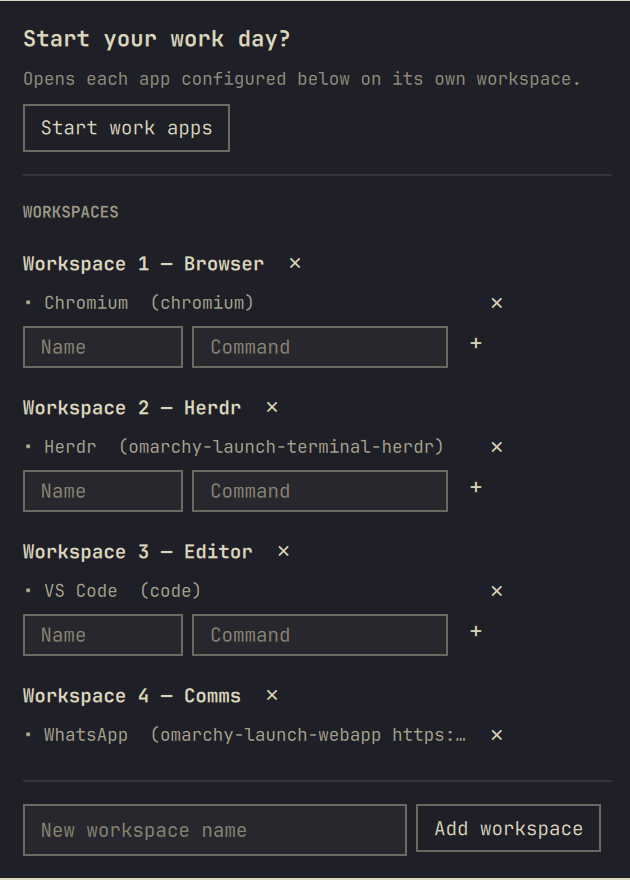
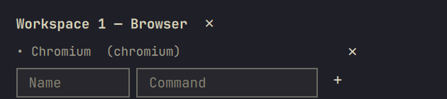

# Omastart

An Omarchy bar widget that asks, right when the shell starts, whether you
want to launch your daily work apps — each one landing on its own
configured workspace, no clicking through window after window.



## Install

```sh
omarchy plugin add https://github.com/diegovrocha/omarchy-omastart.git --enable
```

## Usage

Click the lightning bolt icon in the bar (⚡ filled once you have apps
configured, outline while empty) to open the panel any time. It also opens
itself automatically once per shell session, right after Omarchy starts.

- **Start work apps** — launches every configured app into its workspace.
- **Add an app** — inside a workspace block, fill in a **Name** (just a
  label) and a **Command** (a real shell command) and press **+**.

  

- **Remove an app or workspace** — the ✕ next to each row.
- **Add a workspace** — the field and button at the bottom of the panel.

State is saved to `~/.local/state/omarchy/settings/omastart.json` and
survives plugin updates.

### Command examples

The **Command** field takes anything you'd normally run in a terminal to
open the app. A few examples:

| App | Command |
|---|---|
| Chromium | `chromium` |
| VS Code | `code` |
| A web app | `omarchy-launch-webapp https://web.whatsapp.com/` |
| Herdr | `omarchy-launch-terminal-herdr` |
| An app needing a specific GTK theme | `env GTK_THEME=Adwaita:light dbeaver` |

## Language

The panel's text follows the machine's configured language
(`Qt.locale()`), not whatever language you happen to be using elsewhere —
currently ships with `pt_BR` and an English default/fallback for every
other locale. See `Strings.js` to add more.

## Remove

```sh
omarchy plugin remove dvr.omastart
```

Your saved workspaces/apps stay at
`~/.local/state/omarchy/settings/omastart.json` — delete that file too if
you want a clean slate.

## Development

```sh
omarchy plugin validate .
```
